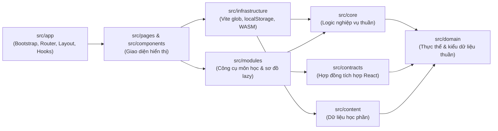

# Hướng dẫn hệ thống — HUS Learning Hub

Tài liệu này giải thích **HUS Learning Hub là gì**, cấu trúc **đường dẫn (URL routes)** của website, **kiến trúc phân tầng**, và **tác dụng chi tiết của từng thư mục / tệp tin** trong mã nguồn.

---

## 1. Tổng quan hệ thống

**HUS Learning Hub** là nền tảng học tập tĩnh (**frontend-only, zero-backend, local-first**) dành cho sinh viên Trường Đại học Khoa học Tự nhiên — ĐHQGHN (VNU-HUS). Toàn bộ ứng dụng được build thành tệp tĩnh trong `dist/` và triển khai trực tiếp lên GitHub Pages (`/HUS_Learning_Page/`), không cần máy chủ backend, cơ sở dữ liệu, tài khoản đăng nhập hay API key.

### Công nghệ cốt lõi

| Thành phần | Công nghệ | Vai trò |
| --- | --- | --- |
| UI & Routing | React 19, React Router 7 (`HashRouter`) | Giao diện SPA, định tuyến bằng hash (`#/...`) để tải lại trang không lỗi 404 trên static host |
| Ngôn ngữ & Build | TypeScript (`strict`), Vite 8 (`base: './'`) | Kiểm tra kiểu nghiêm ngặt, đóng gói tài sản đường dẫn tương đối (`dist/`) |
| Styling & Fonts | Tailwind CSS 4, `Be Vietnam Pro`, `Spectral` | Thiết kế theo chủ đề *Atmospheric Observatory* (Sáng/Tối), font tự lưu trữ cục bộ |
| Nội dung & Toán | `react-markdown`, `remark-gfm`, `remark-math`, `rehype-katex`, `rehype-highlight` | Hiển thị bài học Markdown, bảng GFM, công thức LaTeX (KaTeX) và tô sáng mã nguồn |
| Thực hành Code | CodeMirror 6, Pyodide (WASM Python), CheerpJ (WASM Java) | Soạn thảo và chạy thử Python/Java ngay trên trình duyệt (tải lazy khi người dùng bấm chạy) |
| Kiểm thử | Vitest (unit), Playwright (E2E desktop + mobile) | Kiểm thử logic thuần và luồng người dùng trên bản build production ở subpath `/HUS_Learning_Page/` |

### Quy mô học liệu hiện tại

Hệ thống phân cấp theo mô hình: **Subject (Lĩnh vực) → Course (Học phần) → Chapter (Chương) → Topic (Chủ đề) → Lesson (Bài học) → Exercise (Bài tập)**.

Hiện có **4 lĩnh vực**, **8 học phần**, **308 bài học Markdown/KaTeX**:

| Lĩnh vực (`subjectId`) | `courseId` | Mã học phần | Tên học phần | Số bài học | Công cụ tương tác nổi bật |
| --- | --- | --- | --- | --- | --- |
| `computer-science` | `thcs4` | `THCS4` | Tin học cơ sở 4 | 30 | Code Lab (Python/Java WASM), Parsons Studio, Bubble Sort |
| `computer-science` | `oop` | `OOP` | Lập trình hướng đối tượng | 45 | Code Lab (Java/Python WASM), Parsons Studio |
| `computer-science` | `mat3514` | `MAT3514` | Cấu trúc dữ liệu và Giải thuật | 64 | Code Lab (Python/Java WASM), Bubble Sort |
| `computer-science` | `mat3504` | `MAT3504` | Thiết kế và Phân tích Thuật toán | 60 | Code Lab (Python/Java WASM), Bubble Sort |
| `chemistry` | `general-chemistry` | `CHE1080` | Hóa học đại cương | 48 | Phòng luyện bán tự luận (MO/VB/Nhiệt/Cân bằng/Điện hóa), Kho 202 bài tập, Đối chiếu MIT OCW (11 dạng đề) |
| `physics` | `phy1159` | `PHY1159` | Vật lý đại cương 1 (Cơ – Nhiệt) | 33 | Studio bán tự luận (FBD, Heatmap, Đồ thị 2D, LOL Energy), Đối chiếu đề cương 9 chương & MIT OCW |
| `mathematics` | `mat1091` | `MAT1091` | Giải tích I | 14 | Proof Blocks Studio (khối chứng minh DAG + KaTeX), Luyện trình bày lời giải |
| `mathematics` | `mat1101` | `MAT1101` | Xác suất – Thống kê | 14 | Proof Blocks Studio (khối chứng minh DAG + KaTeX), Luyện trình bày lời giải |

### Kiến trúc phân tầng & chiều phụ thuộc



Nguyên tắc ranh giới bắt buộc:
- **`src/domain/`** và **`src/core/`** hoàn toàn **không import React, DOM hay API trình duyệt** — dễ kiểm thử bằng Vitest thuần Node.js.
- **`src/pages/`** và **`src/components/`** chỉ hiển thị dữ liệu và ủy quyền tính toán cho `src/core/`; **không bao giờ rẽ nhánh theo tên môn học** (mọi công cụ chuyên biệt được gắn thông qua hợp đồng `SubjectModule`).
- **`src/modules/`** được tải động (`lazy-load`) để giữ gói JS chính gọn nhẹ.

---

## 2. Bản đồ đường dẫn Website (URL Routes)

Website dùng `HashRouter` (khai báo tại `src/app/App.tsx`), mọi đường dẫn đều nằm sau dấu `#`:

| Đường dẫn (Hash Path) | Trang xử lý (`src/pages/`) | Tác dụng & Tính năng chính |
| --- | --- | --- |
| `#/` | `CataloguePage.tsx` | Trang chủ (Landing Observatory): giới thiệu hệ thống, thống kê nhanh, nút tiếp tục học, lối tắt theo lĩnh vực |
| `#/courses` | `CoursesPage.tsx` | Vũ trụ học phần dạng quỹ đạo (`OrbitalCourseUniverse`), bộ lọc theo lĩnh vực, tìm kiếm toàn văn tiếng Việt không dấu (`?q=...`) |
| `#/courses/:courseId` | `CoursePage.tsx` | Trang chi tiết học phần: Sơ đồ phụ thuộc DAG (`CourseAtlas`), danh sách bài, luyện trình bày lời giải, và các công cụ môn học. Hỗ trợ `?track=practice\|theory` (với nhóm lập trình) và `?tool=<toolId>&preset=<preset>` |
| `#/courses/:courseId/lessons/:lessonId` | `LessonPage.tsx` | Không gian đọc bài học: mục lục tự động (`outline`), nội dung Markdown + KaTeX + Code, đánh dấu hoàn thành, bài tập trắc nghiệm/tự điền, nút mở phòng luyện bán tự luận hoặc công cụ môn học liên kết |
| `#/courses/:courseId/lessons/:lessonId/practice/:exerciseId` | `PracticePage.tsx` | Studio giải bài tập bán tự luận (`SemiEssayStudio`): bố cục 2 cột (trái: đề bài + lý thuyết neo theo từng bước; phải: các bước giải có sơ đồ tương tác, tự chấm/đối chiếu và ghép thành bài giải hoàn chỉnh) |
| `#/resources` | `ResourcesPage.tsx` | Thư viện tài liệu tham khảo công khai (hiện giữ các video bài giảng công khai như YouTube Hóa học) và tính năng đánh dấu (bookmark) |
| `#/progress` | `ProgressPage.tsx` | Bảng tổng hợp tiến độ học tập từng môn, bài đã hoàn thành, tài liệu đã lưu, **xuất / nhập bản sao lưu JSON** (`hus-progress-v1.json`) |
| `#/settings` | `SettingsPage.tsx` | Cài đặt giao diện (Sáng / Tối / Theo hệ thống) và cỡ chữ đọc bài (`normal` / `comfortable`) |
| `*` (mọi đường dẫn sai) | `NotFoundPage.tsx` | Trang báo lỗi 404 thân thiện có nút quay về Trang chủ hoặc Học phần |

---

## 3. Bản đồ thư mục & tác dụng từng tệp tin

### 3.1. Thư mục gốc (Root) & Cấu hình

| Đường dẫn | Tác dụng |
| --- | --- |
| `index.html` | Tệp HTML gốc, gắn `<div id="root">` và nạp `/src/main.tsx` (Vite tự viết lại đường dẫn khi build) |
| `package.json` | Khai báo thư viện phụ thuộc và các lệnh npm (`dev`, `typecheck`, `test`, `build`, `preview`, `test:e2e`) |
| `package-lock.json` | Khóa phiên bản dependency đảm bảo build nhất quán trên CI và máy cá nhân |
| `tsconfig.json` | Cấu hình TypeScript chế độ `strict` (`noUncheckedIndexedAccess`, `exactOptionalPropertyTypes`, `verbatimModuleSyntax`) |
| `vite.config.ts` | Cấu hình Vite (`base: './'`), Tailwind plugin, chặn dev server đọc `docs/` và `.agents/`, cấu hình Vitest (`tests/unit/**/*.test.ts`) |
| `playwright.config.ts` | Cấu hình kiểm thử E2E trên Desktop Chrome + Mobile iPhone 13, tự chạy `npm run build` và serve tại `/HUS_Learning_Page/` |
| `.github/workflows/deploy.yml` | GitHub Actions CI/CD: kiểm tra PR và tự động deploy **chỉ thư mục `dist/`** lên GitHub Pages khi push lên `main` |
| `.gitignore` | Loại trừ `node_modules/`, `dist/`, các kho tài liệu tham chiếu lớn và bản mirror MIT OCW cục bộ khỏi Git |
| `README.md` | Giới thiệu nhanh dự án và các lệnh phát triển cơ bản |
| `AGENTS.md` | Quy tắc kỹ thuật & ranh giới kiến trúc cho các AI agent làm việc trên repo |
| `DESIGN.md` | Hệ thống thiết kế *Atmospheric Observatory* (bảng màu Sáng/Tối, typography, spacing) |
| `PRODUCT.md` | Định vị sản phẩm, đối tượng người dùng và phạm vi tính năng |
| `public/favicon.svg` | Biểu tượng tab trình duyệt của website |
| `public/licenses/VLDC-HUS-MIT.txt` | Bản sao giấy phép MIT của nguồn học liệu Vật lý đại cương `VLDC-HUS` |
| `.agents/`, `.claude/`, `.codex/`, `.impeccable/`, `skills-lock.json` | Thư mục cấu hình kỹ năng/công cụ hỗ trợ phát triển của AI agent (không thuộc mã nguồn website, không được build vào `dist/`) |

---

### 3.2. `src/main.tsx` và `src/app/` — Khởi động & Khung ứng dụng

| Tệp | Tác dụng |
| --- | --- |
| `src/main.tsx` | Điểm vào React: nạp CSS chính, áp dụng tùy chọn giao diện ban đầu và mount `<App />` trong `StrictMode` |
| `src/app/App.tsx` | Khai báo `ErrorBoundary`, `HashRouter`, toàn bộ `Routes` và `React.lazy()` cho các trang |
| `src/app/ErrorBoundary.tsx` | Bắt lỗi runtime React không mong muốn, hiển thị giao diện khôi phục thay vì trắng trang |
| `src/app/layouts/AppLayout.tsx` | Khung chung của mọi trang: Skip link (trợ năng), thanh điều hướng `ObservatoryHeader`, vùng nội dung `<Outlet />` có `Suspense`, và cử chỉ điều hướng |
| `src/app/route-transition.ts` | Hàm nạp trước (preload) chunk cho `CataloguePage` và `CoursesPage` giúp chuyển trang mượt |
| `src/app/useLearningProgress.ts` | React hook kết nối `progressStore` (`useSyncExternalStore`) để đọc/cập nhật tiến độ học tập |
| `src/app/useWrittenDrafts.ts` | React hook kết nối `WrittenDraftStore` để tự động lưu/khôi phục bản nháp bài tự luận theo từng `exerciseId` |
| `src/app/useWorkspacePreferences.ts` | React hook đọc/ghi theme (Sáng/Tối/Hệ thống) và cỡ chữ đọc bài |
| `src/app/useWorkspaceGestures.ts` | React hook xử lý cử chỉ kéo chạm biên đầu/cuối trang để chuyển sang trang kế tiếp/trước đó |

---

### 3.3. `src/pages/` — Các trang chính của ứng dụng

| Tệp | Tác dụng |
| --- | --- |
| `src/pages/CataloguePage.tsx` | Trang chủ `#/` với hero đài thiên văn, tóm tắt số lượng học liệu, khối tiếp tục học và danh mục lĩnh vực |
| `src/pages/CoursesPage.tsx` | Trang `#/courses`: hiển thị các học phần trên quỹ đạo (`OrbitalCourseUniverse`), lọc theo lĩnh vực và tìm kiếm toàn văn có phân nhóm + phân trang |
| `src/pages/CoursePage.tsx` | Trang `#/courses/:courseId`: hỗ trợ chế độ 2 nhánh (`Thực hành gõ code` / `Lý thuyết & Cơ sở toán học`) cho môn lập trình, hiển thị `CourseAtlas`, danh sách `Luyện trình bày lời giải` và `SubjectToolHost` |
| `src/pages/LessonPage.tsx` | Trang `#/courses/:courseId/lessons/:lessonId`: tải lazy file Markdown của bài học, hiển thị mục lục, liên kết tới công cụ môn học, bài tập tương tác và nút chuyển bài trước/sau |
| `src/pages/PracticePage.tsx` | Trang `#/courses/:courseId/lessons/:lessonId/practice/:exerciseId`: tải bài tập bán tự luận và gắn `SemiEssayStudio` theo `exerciseId` |
| `src/pages/ResourcesPage.tsx` | Trang `#/resources`: duyệt và đánh dấu tài liệu tham khảo công khai |
| `src/pages/ProgressPage.tsx` | Trang `#/progress`: thống kê tiến độ từng môn, danh sách bài đã học/đánh dấu, xuất và khôi phục file JSON tiến độ |
| `src/pages/SettingsPage.tsx` | Trang `#/settings`: tùy chỉnh giao diện sáng/tối và cỡ chữ đọc |
| `src/pages/NotFoundPage.tsx` | Trang báo lỗi 404 khi route không khớp |

---

### 3.4. `src/components/` — Thành phần giao diện tái sử dụng

#### `src/components/courses/` (Hiển thị học phần & công cụ môn)
| Tệp | Tác dụng |
| --- | --- |
| `OrbitalCourseUniverse.tsx` | Giao diện quỹ đạo tương tác cho trang `/courses`, hỗ trợ chuyển trang quỹ đạo mượt bằng GPU transform |
| `CourseCard.tsx` | Thẻ học phần hiển thị mã môn, tên môn, số chương/bài và thanh tiến độ |
| `AtomicCourseEmblem.tsx` | Biểu tượng nguyên tử/quỹ đạo trang trí sinh theo cấu trúc chương-bài của học phần |
| `SubjectToolHost.tsx` | Khung nhúng tổng quát để tải và mở các công cụ lazy trong `SubjectModule` (hỗ trợ `?tool=` và `preset`) |

#### `src/components/learning/` (Hiển thị bài học, sơ đồ phụ thuộc & bài tập)
| Tệp | Tác dụng |
| --- | --- |
| `CourseAtlas.tsx` | Trung tâm điều hướng trong trang học phần với 3 chế độ: `Sơ đồ liên kết` (mặc định), `Danh sách bài`, `Tổng kết & Đề thi` và ô lọc nhanh tiếng Việt |
| `CourseDependencyGraph.tsx` | Sơ đồ phụ thuộc có hướng (DAG) 2 cấp: cấp chương (vĩ mô) và cấp bài học (vi mô), hover để sáng chuỗi bài cần học trước / mở khóa tiếp theo |
| `CourseSyllabus.tsx` | Thành phần hiển thị danh sách chương/chủ đề/bài học dạng tuyến tính |
| `LessonWorkspaceShell.tsx` | Bố cục khung đọc bài học (thanh mục lục dính bên cạnh + cột nội dung chính) |
| `Markdown.tsx` | Bộ render Markdown an toàn (GFM, KaTeX, highlight code, tự gắn `id` cho heading `h2`/`h3`, viết lại link nội bộ) |
| `ExerciseFrame.tsx` | Khung giao diện chung cho một bài tập tương tác đơn lẻ |
| `ExerciseSession.tsx` | Quản lý phiên làm bài tập (trắc nghiệm, tự điền số/chữ, gợi ý từng bước, chấm điểm và lưu tiến độ) |
| `SemiEssayStudio.tsx` | Studio giải bán tự luận 2 cột: đồng bộ lý thuyết bên trái (`TheoryReferenceRail`), điều phối các bước (`choice-reasoning`, `diagram`, `axis-projection`, `equation-transform`, `numeric-unit`, `written-reasoning`) và tổng hợp bài giải hoàn chỉnh |
| `TheoryReferenceRail.tsx` | Cột tham chiếu đề bài, dữ kiện đã cho và các neo lý thuyết tương ứng với bước giải đang làm |
| `WrittenReasoningStepView.tsx` | Giao diện bước tự luận có hướng dẫn: viết nháp lần 1 → xem gợi ý → mở dàn ý tham khảo → tự kiểm theo rubric → viết bản chỉnh sửa → nộp xác nhận |
| `VisualizationFrame.tsx` | Khung chuẩn cho các mô phỏng trực quan tương tác (ví dụ thuật toán sắp xếp) |
| `ResourceList.tsx` | Danh sách tài liệu tham khảo có nút mở và nút đánh dấu |
| `MitVideoCard.tsx` | Thẻ hiển thị tài nguyên bài giảng MIT OpenCourseWare (phân biệt rõ video/PDF/slide, mở link gốc `ocw.mit.edu`/YouTube) |

#### `src/components/ui/` (Thành phần UI nền tảng)
| Tệp | Tác dụng |
| --- | --- |
| `ObservatoryHeader.tsx` | Thanh điều hướng trên cùng (logo, các link trang chính, nút chuyển nhanh Sáng/Tối, menu di động) |
| `ObservatoryCanvas.tsx` | Lớp nền đồ họa vector bầu trời / đường quỹ đạo trang trí |
| `Badge.tsx` | Nhãn trạng thái / mã học phần / loại tài nguyên |
| `Breadcrumbs.tsx` | Thanh điều hướng phân cấp (Trang chủ › Học phần › Tên môn › Bài học) |
| `EmptyState.tsx` | Khối hiển thị trạng thái rỗng khi chưa có dữ liệu hoặc không tìm thấy kết quả |
| `Icons.tsx` | Bộ icon SVG nội tuyến gọn nhẹ, không phụ thuộc thư viện icon ngoài |
| `SearchInput.tsx` | Ô nhập tìm kiếm có nút xóa nhanh và nhãn trợ năng |
| `SearchHighlight.tsx` | Tô sáng từ khóa khớp trong kết quả tìm kiếm tiếng Việt không dấu và trích xuất đoạn ngữ cảnh ngắn |
| `Skeleton.tsx` | Hiệu ứng khung chờ (loading skeleton) khi đang tải trang/bài học lazy |
| `ScrollReveal.tsx` | Hiệu ứng hiện dần nhẹ khi cuộn tới (tôn trọng `prefers-reduced-motion`) |
| `TaglineReveal.tsx` | Hiệu ứng hiển thị dòng khẩu hiệu ở phần Hero trang chủ |

---

### 3.5. `src/domain/` — Thực thể & Hợp đồng dữ liệu thuần (React-free)

| Tệp | Tác dụng |
| --- | --- |
| `src/domain/learning.ts` | Định nghĩa các thực thể cốt lõi: `Subject`, `Course`, `Chapter`, `Topic`, `Lesson`, `Resource`, `Provenance`, `LearningProgress` |
| `src/domain/workspace.ts` | Định nghĩa `LearningContent`, union `ExerciseDefinition` (trắc nghiệm, tự điền, bán tự luận), `ProgressState`, `ProgressAction` |
| `src/domain/semi-essay.ts` | Kiểu dữ liệu cho `SemiEssayExercise`, `TheoryAnchor`, các loại bước giải (`DiagramStep` với FBD/Heatmap/Curve2D/BalanceFlow, `WrittenReasoningStep`, v.v.) |
| `src/domain/code-lab.ts` | Kiểu dữ liệu cho bài tập lập trình (`CodeLabProblem`, `TestCase`, `JudgeResult`, ngôn ngữ Python/Java) |
| `src/domain/block-logic.ts` | Kiểu dữ liệu cho bài ghép khối mã nguồn (`ParsonsExercise`) và bài ghép khối chứng minh Toán (`ProofBlocksExercise` dạng DAG) |
| `src/domain/che1080-bank.ts` | Kiểu dữ liệu cho kho 202 bài tập Hóa học đại cương CHE1080 (phân cấp `basic` / `standard` / `advanced`) |
| `src/domain/mit-che1080.ts` | Kiểu dữ liệu cho ánh xạ 11 dạng đề CHE1080 với kho bài giảng MIT OCW (`5.111SC`, `5.112`, `5.60`) |
| `src/domain/phy1159-syllabus.ts` | Kiểu dữ liệu cho đề cương 9 chương PHY1159, mục `Tự học`, và tài nguyên MIT OCW (`8.01SC`, `5.60`, `8.044`) |

---

### 3.6. `src/core/` — Logic nghiệp vụ thuần (React-free, Browser-free)

#### `src/core/courses/`
| Tệp | Tác dụng |
| --- | --- |
| `registry.ts` | `createCourseRegistry()`: kiểm tra tính duy nhất của ID, tính hợp lệ của `subjectId`, đóng băng (`Object.freeze`) danh mục học phần |
| `search.ts` | `normalizeVietnamese()` (chuẩn hóa tiếng Việt không dấu) và hàm lọc/tìm kiếm học phần |

#### `src/core/learning/`
| Tệp | Tác dụng |
| --- | --- |
| `content.ts` | `validateContent()`, `validateExercises()`, kiểm tra toàn vẹn tham chiếu giữa chương–chủ đề–bài học–bài tập và phát hiện chu trình (cycle) điều kiện tiên quyết |
| `graph.ts` | `buildChapterGraph()` và `buildLessonGraph()`: tính phân tầng tô-pô (topological tiers), sắp xếp hàng barycenter, tìm tổ tiên/hậu duệ bắc cầu và cầu nối liên chương |
| `exercises.ts` | Logic chấm bài tập trắc nghiệm và tự điền cơ bản |
| `semi-essay.ts` | Logic chấm các bước bán tự luận (`parseLocalizedNumber` hỗ trợ dấu phẩy thập phân tiếng Việt, `evaluateChoiceReasoningStep`, `evaluateAxisProjectionStep`, `evaluateEquationTransformMove`, `evaluateNumericUnitStep`, `evaluateWrittenReasoningReview`, `buildSynthesizedEssay`) |
| `fbd.ts` | Thuật toán chấm sơ đồ lực tự do (Free-Body Diagram): xử lý góc vòng 0°/360°, kiểm tra vector thiếu/thừa/ngược hướng và mô-men xoắn mở rộng |
| `heatmap.ts` | Thuật toán chấm bản đồ nhiệt 2D (`select-cells`, `place-flow`, `paint-state`) và bảng màu `mapHeatColor` thân thiện với người mù màu |
| `curve-2d.ts` | Tính diện tích hình thang dưới đồ thị 2D (`v(t)`), chấm chọn vùng và bảng dấu nhiệt động lực học (`ΔU, A, Q`) |
| `balance-flow.ts` | Chấm biểu đồ cột năng lượng LOL (`∑E₁ + W_ext = ∑E₂`) và kiểm tra bảo toàn năng lượng |
| `progress.ts` | Quản lý trạng thái tiến độ bất biến (`emptyProgress`, `updateProgress`, `parseProgress` kiểm tra schema JSON khi nhập sao lưu) |
| `search.ts` | Tìm kiếm toàn văn trên toàn bộ học liệu có bộ đệm `WeakMap` để gõ phím không bị giật lag |
| `outline.ts` | Phân tích Markdown để trích xuất danh sách tiêu đề `h2`/`h3` và tạo slug ID |
| `replay.ts` | Sinh từng bước thực thi cho mô phỏng thuật toán `bubbleSortSteps` |
| `elements.ts` | Dữ liệu cấu hình lớp vỏ electron nguyên tố hóa học (Z = 1..36) dùng để tạo biểu tượng nguyên tử tương ứng số chương/bài |
| `written-content.ts` | Hàm `withWrittenPractice()` ghép bài luyện trình bày lời giải vào nội dung học phần có kiểm tra trùng lặp |

#### `src/core/code-lab/`, `src/core/blocks/`, `src/core/chemistry/`, `src/core/physics/`, `src/core/navigation/`
| Tệp | Tác dụng |
| --- | --- |
| `src/core/code-lab/judge.ts` | Chuẩn hóa output (`normalizeOutput`), chấm test case (`judgeTestCase`, `summarizeJudge`), trích xuất tên lớp `main` trong Java |
| `src/core/blocks/parsons.ts` | Chấm bài ghép khối mã nguồn Parsons 2 chiều (đúng thứ tự, đúng thụt lề, phát hiện khối nhiễu/thiếu) |
| `src/core/blocks/proof-dag.ts` | Kiểm tra đồ thị chứng minh không có chu trình (`validateProofDag`) và chấm bài ghép khối chứng minh chấp nhận mọi thứ tự tô-pô hợp lệ (`gradeProofBlocks`) |
| `src/core/chemistry/essay-engine.ts` | Logic hóa học bán tự luận: thứ tự mức năng lượng MO (Loại I/II), điền electron Aufbau–Hund–Pauli, tính bậc liên kết & từ tính, $\Delta G^\circ(T)$, $\Delta n_{\text{khí}}$, chu trình Hess |
| `src/core/chemistry/equil-electro-engine.ts` | Logic tính toán cân bằng hóa học (ICE/Buffer pH) và pin điện hóa (Nernst, suất điện động) |
| `src/core/chemistry/practice-bank.ts` | Lọc, tìm kiếm và chọn đại diện `1 câu / cấp độ khó` cho kho 202 bài tập CHE1080 |
| `src/core/chemistry/mit-mapping.ts` | Lọc, tìm kiếm và theo dõi tiến độ trên 11 dạng đề CHE1080 đối chiếu MIT OCW |
| `src/core/chemistry/che1080-calc.ts` | Các hàm máy tính bỏ túi nhanh cho Hóa đại cương (pH, Nernst, khí lý tưởng, hằng số cân bằng) |
| `src/core/physics/syllabus-ocw.ts` | Lọc/tìm kiếm đề cương 9 chương PHY1159 & theo dõi trạng thái đã ôn tập theo từng chương |
| `src/core/navigation/gestures.ts` | Xác định trang đích trên/dưới (`resolveBoundaryTargets`) và bộ đếm thời gian xác nhận cử chỉ 2 bước chống trôi touchpad |

---

### 3.7. `src/contracts/` — Hợp đồng tích hợp

| Tệp | Tác dụng |
| --- | --- |
| `src/contracts/subject-module.ts` | Định nghĩa `SubjectModule`, `SubjectToolDescriptor` (`load`, `courseIds`, `lessonLinks`, `trackMode`) để gắn công cụ chuyên môn vào môn học mà trang chung không cần biết chi tiết |
| `src/contracts/diagram-module.ts` | Định nghĩa hợp đồng `DiagramModule` cho các sơ đồ tương tác lazy trong `SemiEssayStudio` |

---

### 3.8. `src/infrastructure/` — Hạ tầng (Vite, Bộ nhớ trình duyệt, WASM)

| Tệp | Tác dụng |
| --- | --- |
| `src/infrastructure/content/catalogue.ts` | Tự động quét `src/content/courses/*/course.ts` bằng `import.meta.glob` (eager) để dựng `courseRegistry` và tra cứu `SubjectModule` |
| `src/infrastructure/content/learning.ts` | Quét `content.ts`, kiểm tra toàn vẹn học liệu lúc khởi động, và cung cấp hàm tải lazy cho `lessons/*.md` và `exercises.ts` |
| `src/infrastructure/content/search.ts` | Quét `search-index.ts` của các học phần để tạo mảng `searchEntries` (chỉ nạp khi mở trang tìm kiếm) |
| `src/infrastructure/content/written-practice.ts` | Quét `written-practice.ts` của tất cả 8 học phần |
| `src/infrastructure/content/resource-url.ts` | Ghép `import.meta.env.BASE_URL` với đường dẫn tài sản (mã hóa Unicode) và gắn `#page=` cho PDF nếu có |
| `src/infrastructure/progress/store.ts` | Lưu trữ tiến độ học tập vào `localStorage` (`hus-learning-hub:progress:v1`), bảo vệ dữ liệu cũ nếu bị hỏng và fallback về RAM khi trình duyệt chặn storage |
| `src/infrastructure/practice/written-drafts.ts` | Lưu trữ bản nháp tự luận theo từng `exerciseId`, kiểm tra schema runtime và tự hủy trạng thái tự chấm nếu người dùng sửa lại bài |
| `src/infrastructure/preferences/theme.ts` | Đọc/ghi cài đặt giao diện (`hus-learning-hub:prefs:v1`) và áp dụng class/attribute lên `<html>` |
| `src/infrastructure/runtimes/types.ts` | Kiểu chung cho kết quả thực thi mã nguồn WASM (`stdout`, `stderr`, `status`, timeout) |
| `src/infrastructure/runtimes/pyodide.worker.ts` | Web Worker tải Pyodide (Python WASM) theo yêu cầu, cô lập `stdin`/`stdout`/`stderr` |
| `src/infrastructure/runtimes/pyodide-runtime.ts` | Bộ điều khiển worker Pyodide, hỗ trợ hủy chạy khi quá thời gian (`worker.terminate()`) và báo lỗi rõ khi offline |
| `src/infrastructure/runtimes/cheerpj-runtime.ts` | Bộ nạp CheerpJ 5.0 (Java 17 WASM), biên dịch bằng `javac` và chạy qua lớp bọc `__HusRunner.java` hỗ trợ UTF-8 |

---

### 3.9. `src/modules/` — Công cụ chuyên môn & Sơ đồ tương tác (Lazy-loaded)

| Đường dẫn | Tác dụng |
| --- | --- |
| `src/modules/subjects.ts` | **Sổ đăng ký tập trung** mọi công cụ môn học (`code-lab`, `parsons-studio`, `bubble-sort`, `proof-blocks`, `chemistry-essay-lab`, `che1080-mit-hub`, `phy1159-syllabus-ocw`) và `lessonLinks` |
| `src/modules/code-lab/CodeLabWorkspace.tsx` | Phòng thực hành Code: chọn bài theo môn, chuyển Python/Java, chạy thử với `stdin` tùy ý hoặc chấm toàn bộ test case, lưu nháp cục bộ |
| `src/modules/code-lab/CodeEditor.tsx` | Trình soạn thảo CodeMirror 6 hỗ trợ cú pháp Python/Java và theme đồng bộ Sáng/Tối |
| `src/modules/blocks/ParsonsStudio.tsx` | Phòng luyện ghép khối mã nguồn Java (kéo/sắp xếp thứ tự + thụt lề + lọc khối nhiễu) cho `THCS4` và `OOP` |
| `src/modules/blocks/ProofBlocksStudio.tsx` | Phòng luyện ghép khối chứng minh Toán học có công thức KaTeX cho `MAT1091` và `MAT1101` |
| `src/modules/algorithms/BubbleSortTool.tsx` | Mô phỏng trực quan từng bước thuật toán sắp xếp nổi bọt |
| `src/modules/chemistry/ChemistryEssayLab.tsx` | Phòng luyện Hóa đại cương 3 chế độ: Tương tác trực quan (MO/VB/Nhiệt/Cân bằng/Điện hóa), 1 câu/cấp độ khó (7 chương), và Kho luyện tập 202 bài |
| `src/modules/chemistry/MoDiagramCanvas.tsx` | Sơ đồ giản đồ MO tương tác SVG có hoạt ảnh hoán đổi mức năng lượng Loại I ↔ II và điền electron từng bước |
| `src/modules/chemistry/VbOverlapCanvas.tsx` | Mô phỏng 3 giai đoạn thuyết VB & lai hóa (`AO tách rời → Lai hóa → Xen phủ σ/π`) |
| `src/modules/chemistry/ThermoDiagramCanvas.tsx` | Đồ thị $\Delta G^\circ(T)$ có thanh trượt nhiệt độ và công cụ đảo/nhân hệ số chu trình Hess |
| `src/modules/chemistry/EquilElectroCanvas.tsx` | Mô phỏng trực quan bảng ICE / Dung dịch đệm (Ch.4 & 6) và Pin điện hóa Galvani / Nernst (Ch.7) |
| `src/modules/chemistry/Che1080PracticeBank.tsx` | Giao diện duyệt, lọc, tìm kiếm và tự kiểm cho 202 bài tập CHE1080 |
| `src/modules/chemistry/Che1080MitHub.tsx` | Trung tâm đối chiếu 11 dạng đề CHE1080 với bài giảng MIT OCW + bộ lọc và theo dõi tiến độ |
| `src/modules/chemistry/Che1080QuickCalc.tsx` | Bảng máy tính nhanh hóa học tích hợp trong `Che1080MitHub` |
| `src/modules/chemistry/problems.ts` | Bộ bài tập trực quan hóa học (MO/VB/Nhiệt/Cân bằng/Điện hóa) dùng trong `ChemistryEssayLab` |
| `src/modules/physics/Phy1159SyllabusExplorer.tsx` | Trình khám phá đề cương chính thức 9 chương PHY1159 đối chiếu với bài học web và bài giảng MIT OCW |
| `src/modules/diagrams/registry.ts` | Sổ đăng ký lazy cho 4 họ sơ đồ tương tác của `SemiEssayStudio` |
| `src/modules/diagrams/FbdDiagram.tsx` | Sơ đồ vẽ lực tự do (Free-Body Diagram) + chế độ vật rắn có cánh tay đòn |
| `src/modules/diagrams/HeatmapDiagram.tsx` | Lưới bản đồ nhiệt 2D tương tác (chọn ô đẳng nhiệt, đặt vector dòng nhiệt, tô trạng thái) |
| `src/modules/diagrams/Curve2dDiagram.tsx` | Đồ thị 2D tương tác (chọn vùng diện tích dưới đường cong `v(t)` hoặc điền bảng dấu chu trình `P–V`) |
| `src/modules/diagrams/BalanceFlowDiagram.tsx` | Biểu đồ cột bảo toàn năng lượng LOL tương tác |

---

### 3.10. `src/content/` — Kho dữ liệu học liệu

| Đường dẫn | Tác dụng |
| --- | --- |
| `src/content/subjects.ts` | Danh sách 4 lĩnh vực chính (`computer-science`, `chemistry`, `physics`, `mathematics`) |
| `src/content/courses/<courseId>/course.ts` | **Metadata học phần** (ID, mã môn, tiêu đề, trạng thái, danh sách `chapterIds`). Chỉ cần thêm tệp này là hệ thống tự động nhận diện học phần mới |
| `src/content/courses/<courseId>/content.ts` | Khai báo cấu trúc `chapters`, `topics`, `lessons`, `resources`, điều kiện tiên quyết và ghép các bài tập |
| `src/content/courses/<courseId>/lessons/*.md` | Nội dung chi tiết từng bài học định dạng Markdown + LaTeX (UTF-8), chỉ được tải khi mở bài |
| `src/content/courses/<courseId>/search-index.ts` | Văn bản bài học đã trích sẵn để phục vụ tìm kiếm toàn văn trên `/courses` |
| `src/content/courses/<courseId>/written-practice.ts` | Các hoạt động `Luyện trình bày lời giải` (tự luận có hướng dẫn + tự kiểm rubric) của học phần |
| `src/content/courses/<courseId>/exercises.ts` | *(Tùy chọn, hiện có ở `general-chemistry`)* Kho bài tập trắc nghiệm lớn được tách riêng để lazy-load |
| `src/content/courses/<courseId>/semi-essays.ts` | *(Hiện có ở `phy1159`, `general-chemistry`)* Các bài tập bán tự luận đa bước có sơ đồ tương tác |
| `src/content/courses/general-chemistry/che1080-bank.ts` | Kho 202 bài tập Hóa học đại cương CHE1080 nhập từ LaTeX (lazy chunk riêng) |
| `src/content/courses/phy1159/syllabus-ocw.ts` | Dữ liệu đề cương 9 chương PHY1159 đối chiếu với bài học web và tài nguyên MIT OCW |
| `src/content/code-lab/problems.ts` | Kho 36 bài tập lập trình Python & Java (`thcs4`: 9, `oop`: 11, `mat3514`: 8, `mat3504`: 8) kèm test case |
| `src/content/blocks/parsons-bank.ts` | Kho 10 bài tập ghép khối mã nguồn Parsons (`thcs4`: 5, `oop`: 5) |
| `src/content/blocks/proof-bank.ts` | Kho 12 bài tập ghép khối chứng minh Toán học DAG (`mat1091`: 6, `mat1101`: 6) |
| `src/content/mit/che1080-topics.ts` & `che1080-resources.ts` | Danh mục 11 dạng đề CHE1080 và 241 mục bài giảng MIT OCW đã xác minh |

---

### 3.11. `src/styles/` & `src/assets/` — Giao diện & Font chữ

| Đường dẫn | Tác dụng |
| --- | --- |
| `src/styles/index.css` | Điểm vào Tailwind CSS, biến màu token Sáng/Tối, nút bấm `.hus-btn`, card, và keyframes animation (tôn trọng `prefers-reduced-motion`) |
| `src/styles/fonts.css` & `spectral-fonts.css` | Khai báo `@font-face` cho font chữ tự lưu trữ `Be Vietnam Pro` và `Spectral` |
| `src/styles/written-practice.css` | Kiểu dáng chuyên biệt cho thanh tiến trình 4 giai đoạn và hiệu ứng mở gợi ý/đáp án trong bước tự luận |
| `src/assets/fonts/` | Các tệp `.woff2` (hỗ trợ đầy đủ tiếng Việt) và giấy phép OFL của font chữ |

---

### 3.12. `scripts/` — Script nhập liệu tự động (chỉ chạy cục bộ)

Các script Node.js này đọc nguồn gốc từ `docs/` (khi có bản lưu cục bộ) và sinh ra mã TypeScript/Markdown chuẩn hóa trong `src/content/`:

| Tệp | Tác dụng |
| --- | --- |
| `scripts/import-dsa.mjs` | Nhập 4 học phần KHMT (`MAT3504`, `MAT3514`, `THCS4`, `OOP`) từ `docs/DSA-HUS`, kiểm tra hash nguồn từ `DSA_SOURCE_HASHES.json` |
| `scripts/import-chemistry.mjs` | Nhập 7 chương, 48 bài học và 296 bài tập Hóa đại cương từ `docs/Chemistry` |
| `scripts/import-che1080-bank.mjs` | Phân tích 7 file `.tex` (`c1.tex..c7.tex`) thành 202 bài tập KaTeX-safe trong `che1080-bank.ts` |
| `scripts/import-mit-che1080.mjs` | Quét bản mirror MIT OCW cục bộ (`5.111sc`, `5.112`, `5.60`) để sinh bảng mục lục `che1080-resources.ts` |
| `scripts/import-physics.mjs` | Phân tích tĩnh AST các tệp dữ liệu trong `docs/VLDC-HUS` (không chạy JS cũ) để sinh 11 chương, 33 bài học, 57 bài tập PHY1159 |
| `scripts/import-source-metadata.mjs` | Tiện ích kiểm tra/trích xuất metadata nguồn gốc từ các dự án tham chiếu |

---

### 3.13. `tests/` — Kiểm thử tự động

| Thư mục | Số lượng | Tác dụng |
| --- | --- | --- |
| `tests/unit/*.test.ts` | 32 tệp | Kiểm thử Vitest trên Node.js cho toàn bộ `src/core/`, tính toàn vẹn dữ liệu `src/content/`, bộ chấm FBD/Heatmap/Curve2D/BalanceFlow/CodeLab/Parsons/ProofDAG, tìm kiếm, lưu tiến độ và bản nháp |
| `tests/e2e/*.spec.ts` | 13 tệp | Kiểm thử Playwright trên trình duyệt thật (Desktop Chrome + Mobile iPhone 13) chạy bản build production tại `/HUS_Learning_Page/`: điều hướng, tìm kiếm, học bài, làm bài tập, Code Lab, Chemistry Lab, Semi-Essay Studio, PHY1159 Syllabus, không tràn ngang (overflow) |

---

### 3.14. `docs/` — Tài liệu kỹ thuật & Kho tham chiếu cục bộ (không deploy)

> **Lưu ý:** Toàn bộ `docs/` **không bao giờ được đóng gói vào `dist/` hay deploy lên web**.

| Đường dẫn trong `docs/` | Phân loại | Tác dụng |
| --- | --- | --- |
| `docs/SYSTEM_GUIDE.md` | Tài liệu dự án | Tài liệu hướng dẫn toàn hệ thống (tệp này) |
| `docs/AGENT_HANDOFF.md` | Tài liệu dự án | Nhật ký bàn giao theo từng giai đoạn phát triển, kết quả kiểm thử và giới hạn đã biết |
| `docs/che1080-mit-integration.md` | Tài liệu dự án | Ghi chú chi tiết tích hợp CHE1080 với MIT OCW |
| `docs/architecture/` | Tài liệu kiến trúc | Quyết định kiến trúc (`README.md`, `PHASE_3.md`, `WRITTEN_PRACTICE.md`, `COURSE_CATALOGUE_SCALABILITY.md`, `ARCHIVE_IMPORT.md`, `REFERENCE_ANALYSIS.md`, `IMPLEMENTATION_PLAN.md`) và các bảng ánh xạ ID/hash (`*_ID_MAP.json`, `DSA_SOURCE_HASHES.json`, `inventory/`) |
| `docs/superpowers/`, `docs/plans/` | Thiết kế & Kế hoạch | Đặc tả thiết kế (`specs/`) và kế hoạch triển khai (`plans/`) cho các tính năng lớn |
| `docs/DSA-HUS/`, `docs/Chemistry/`, `docs/VLDC-HUS/`, `docs/HUS-learning-resource/` | Kho nguồn cục bộ (gitignored) | Các dự án tham chiếu và kho học liệu gốc để chạy script nhập liệu; không phải mã nguồn chạy của app |
| `docs/5.111sc-*`, `5.112-*`, `5.60-*`, `8.01sc-*`, `8.044-*`, `MIT_additional_physics/`, `*.pdf` | Kho tham chiếu cục bộ (gitignored) | Bản mirror MIT OCW và các tệp PDF đề cương/bài tập dùng để đối chiếu nội dung chính xác |

---

## 4. Dữ liệu lưu cục bộ trên trình duyệt (`localStorage`)

Mọi dữ liệu người dùng đều lưu riêng trên trình duyệt hiện tại, có cơ chế chống lỗi khi trình duyệt chặn `localStorage` hoặc dữ liệu bị hỏng:

| Key `localStorage` | Quản lý tại | Dữ liệu lưu trữ |
| --- | --- | --- |
| `hus-learning-hub:progress:v1` | `src/infrastructure/progress/store.ts` | Bài học đã hoàn thành, lịch sử làm bài tập, tài liệu đã đánh dấu (có thể xuất/nhập JSON) |
| `hus-learning-hub:prefs:v1` | `src/infrastructure/preferences/theme.ts` | Tùy chọn giao diện (`system`/`light`/`dark`) và cỡ chữ đọc (`normal`/`comfortable`) |
| `hus-learning-hub:written-draft:v1:<exerciseId>` | `src/infrastructure/practice/written-drafts.ts` | Bản nháp câu trả lời, danh sách tiêu chí tự kiểm và bản chỉnh sửa cho từng bài tự luận |
| `hus-code-lab:draft:v1:<problemId>:<lang>` | `src/modules/code-lab/CodeLabWorkspace.tsx` | Mã nguồn nháp Python/Java người dùng đang gõ |
| `hus-code-lab:solved:v1` | `src/modules/code-lab/CodeLabWorkspace.tsx` | Danh sách ID bài lập trình đã vượt qua toàn bộ test case |
| `hus-che1080-practice-solved:v1` | `src/modules/chemistry/Che1080PracticeBank.tsx` | Danh sách bài tập trong kho 202 bài CHE1080 đã đánh dấu hoàn thành |
| `hus-learning-hub:che1080-mit:v1` | `src/core/chemistry/mit-mapping.ts` | Trạng thái ôn tập trong trung tâm đối chiếu CHE1080 & MIT OCW |
| `hus-learning-hub:phy1159-syllabus:v1` | `src/core/physics/syllabus-ocw.ts` | Trạng thái đã rà soát từng chương trong đề cương 9 chương PHY1159 |

---

## 5. Thao tác nhanh cho lập trình viên

### Các lệnh thường dùng

```sh
npm ci                  # Cài đặt dependency đúng theo package-lock.json
npm run dev             # Chạy máy chủ phát triển cục bộ (Vite)
npm run typecheck       # Kiểm tra kiểu TypeScript nghiêm ngặt
npm test                # Chạy toàn bộ unit test (Vitest)
npm run build           # Chạy lần lượt: typecheck -> unit test -> build ra dist/
npm run preview         # Xem trước bản build production cục bộ
npm run test:e2e        # Chạy toàn bộ E2E test Playwright (Desktop + Mobile)
```

### Cách thêm một học phần mới

1. Nếu thuộc lĩnh vực mới, thêm 1 mục vào `src/content/subjects.ts`.
2. Tạo thư mục `src/content/courses/<course-id>/` (dùng chữ thường `kebab-case`, ví dụ `mat1092`).
3. Tạo tệp `course.ts` export default đối tượng thỏa mãn kiểu `Course`.
4. Tạo `content.ts`, `lessons/*.md`, `search-index.ts` (và tùy chọn `written-practice.ts`, `exercises.ts`, `semi-essays.ts`).
5. **Không cần sửa file route** — `catalogue.ts` và `learning.ts` sẽ tự động phát hiện học phần mới qua `import.meta.glob` và phục vụ ngay tại `#/courses/<course-id>`.
6. Chạy `npm run build` để kiểm tra tính toàn vẹn tham chiếu và không có chu trình tiên quyết.
